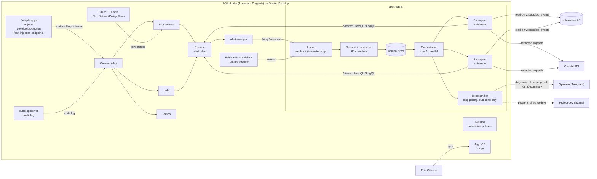

# k8s-ai-sre-harness

**Kubernetes AI SRE Harness**

[](https://github.com/dunghv107/k8s-ai-sre-harness/actions/workflows/ci.yml)

**[English](#english) · [Tiếng Việt](#tiếng-việt)**

A production-replica Kubernetes lab (k3d) running entirely in Docker on one workstation, plus an AI agent harness
that triages alerts in real time.
Lab Kubernetes mô phỏng production (k3d, quy mô nhỏ hơn), chạy hoàn toàn trong Docker trên một máy, kèm một AI agent harness phân
loại cảnh báo theo thời gian thực.



---

## English

> **A scaled-down production-replica lab of a real production setup.** Every flow here (GitOps delivery, CI security gates,
> ingress, admission and network policy, observability, alert routing and chat-ops triage) mirrors the platform
> I designed and operated in production at **DFM** across two Kubernetes clusters. The lab runs the same
> flows on one machine, with open-source substitutes where the production tool is too heavy for a laptop.
> No company data, hostnames or credentials are included. The AI triage agent is the new part, built on top of
> the alert pipeline that ran in production.

> **Status:** running today: the production-replica lab, the full alert pipeline (four-language sample app with 100 % tracing,
> metrics/logs/traces, a simple SIEM with API audit log + Falco, Telegram alerts) and the AI triage agent MVP
> (receive, dedupe, transient-failure gate, read-only investigation, Telegram diagnosis). Not built yet: the later
> phases listed in [spec 001](specs/001-realtime-alert-triage/spec.md) (dev message drafts, Telegram commands,
> 08:30 summary).

### Run the demo

```bash
bash scripts/up.sh          # k3d cluster (1 server + 2 agents), audit log, Cilium + Hubble
cp .env.example .env        # fill TELEGRAM_BOT_TOKEN and TELEGRAM_ALERT_CHAT_ID
bash scripts/platform.sh    # Prometheus, Alertmanager → Telegram, Grafana, Loki, Tempo, Alloy, Falco, SIEM rules
bash scripts/deploy-apps.sh # Postgres + shop-web (Next.js), orders-api (Node), catalog-api (Python), invoice-api (Go)
bash scripts/deploy-agent.sh # builds the alert-agent image, creates its Secret from .env, deploys it to the alerting namespace
kubectl -n shop port-forward svc/shop-web 3000:3000   # open http://localhost:3000, press "product 4" for a real 500
```

What to expect in Telegram: the alert bot posts the raw alert for the
500, and after the 60 s batching window the agent bot posts one diagnosis message (see below).

Detection rules and how to trigger each one: [docs/siem.md](docs/siem.md). Service contract: [docs/contract.md](docs/contract.md).

Demo walkthrough: [docs/demo.md](docs/demo.md).

### Why

On-call ends at 17:30. Alerts that fire overnight pile up until the next morning: out of 100 alerts, ~80 are the
same 5xx error from one app. The goal is to arrive in the morning to a handful of incidents that are already
diagnosed, with evidence, and with the message to developers ready to send.

### Production at DFM → this lab

| Flow | Production (DFM) | Lab |
|---|---|---|
| Clusters | 2 clusters (France, Vietnam), multi-node, kubeadm / RKE2 | 1 k3d cluster, 1 server + 2 agents |
| Delivery | Tag-driven CI → image tag written to GitOps repo → Argo CD sync, shared Helm chart for every app | Same model: GitHub Actions → GitOps → Argo CD, shared chart |
| CI security gates | SonarQube, Trivy (fail on HIGH/CRITICAL), DAST, SBOM to Dependency-Track, auto-rollback | Equivalent open-source gates in GitHub Actions |
| Ingress | Edge reverse proxy (TLS) → Traefik + Gateway API (shared Gateway, per-app HTTPRoute) | Traefik + Gateway API on localhost |
| Admission | Pod Security + "internal registry only" image policy | Kyverno + Pod Security `restricted`, local registry allow-list |
| Network | CNI with NetworkPolicy, default-deny, quarantine label | Cilium + Hubble, default-deny |
| Runtime / SIEM | Falco, Wazuh SIEM | Falco (Wazuh too heavy for one host) |
| Secrets | Vault + External Secrets, Sealed Secrets per cluster | Sealed Secrets |
| Observability | Grafana, Prometheus, Loki, Tempo, Alloy, OpenTelemetry at 100 % sampling | Same stack, in-cluster |
| Alerting | Webhook receiver → fingerprint dedupe → chat room with commands (`#id safe/done/real`), monthly incident table | Same flow on Telegram, **plus the AI agent** that diagnoses each incident |

### AI alert agent

Spec: [specs/001-realtime-alert-triage](specs/001-realtime-alert-triage/spec.md) · design rules: [constitution](.specify/memory/constitution.md).

**Two bots in one Telegram group.** The alert bot (driven by Alertmanager) posts the raw alert. The agent bot posts
the diagnosis. Telegram bots cannot read other bots' messages, so the agent does not read the group: it receives the
same alert through the Alertmanager webhook, which accepts traffic from inside the cluster only.

**Journey of one alert**

| Step | What happens |
|---|---|
| 1 Store | Alert written to SQLite before answering Alertmanager, so a pod crash loses nothing |
| 2 Dedupe | Fingerprint (rule + service + route); a repeat of an open incident only bumps a counter, no new message |
| 3 Batch | New incident waits 60 s; same-project incidents within 120 s are handled together |
| 4 Gate | Rollout in progress, pod younger than 3 min, already resolved, fewer than 3 errors in 2 min: held, **no model call** |
| 5 Investigate | One sub-agent per incident, up to 5 in parallel, max 8 tool calls and 300 s each |
| 6 Conclude | JSON with label, confidence, cause, evidence, next action; no evidence means "not enough evidence" |
| 7 Send | Secrets redacted, message rendered, sent by the agent bot |

Security alerts (audit log, Falco) skip the gate, are never auto-closed and use the stronger model.

**Read-only tools:** `list_pods`, `get_pod_logs`, `get_events`, `get_rollout`, `query_metrics` (Prometheus),
`query_logs` (Loki), `search_traces` / `get_trace` (Tempo). Model: `gpt-6.1-terra`, escalated to `gpt-6.1-sol` for
security incidents or low-confidence answers.

**A real diagnosis.** Product 4 returns HTTP 500. The agent read the catalog-api pod log, followed the trace id into
Tempo, found the root service and the code line. It posts in Vietnamese; translated here:

```
🧠 Diagnosis #2 · catalog-api · Http5xxRate
🏷️ app · ongoing · confidence high
🎯 catalog-api fails when querying product 4, so shop-web returns HTTP 500.
🔎 IndexError when reading the first element of product["variants"] in price_of.
📎 logs: main.py:57, price_of ... IndexError: list index out of range
📎 trace: shop-web /api/products/4: 500; catalog-api ... ERROR
➡️ Pass the trace and the error to the dev team to check product 4's variant data
⏱️ 13:07 · 1 occurrence · gpt-6.1-terra · 0.029 USD
```

Four alerts (5xx and error logs from two services) produced one diagnosis, not four.

**Safety**
- Read-only RBAC: `get/list/watch` on pods, logs, events, deployments; no Secrets, no exec, no writes.
- Redaction: tokens, passwords, keys, emails are replaced with `«redacted»` before the model and before Telegram.
- Logs are data, not instructions (prompt-injection stance); a test plants a secret in logs and checks it never
  reaches the OpenAI or Telegram request.
- Egress limited to DNS, the API server, Prometheus/Loki/Tempo and HTTPS to OpenAI and Telegram.
- Daily cost cap of 2 USD: over the cap, incidents are still reported but not analysed.

**Measured cost** (on this production-replica lab, with `gpt-6.1-terra` / `gpt-6.1-sol`; token counts from the agent's own `runs`
table): about **0.023 USD per pod-error diagnosis** with Terra (range 0.016 to 0.029, 6 to 8 tool calls, 13k to 25k
input tokens) and about 0.009 USD for a security incident with Sol. At the 2 USD cap that is roughly 85 such
diagnoses per day. Total agent spend during the build was about 0.09 USD. OpenAI cost only; details in the build log.

**Not built yet** (spec 001, later phases): drafted messages for developers, Telegram commands (`/verify`, `/hold`,
`/approve`, `/reopen`), the 08:30 workday summary. Known issue in the build log: two alert groups with the same
correlation id can still produce two identical diagnoses.

#### Native engine vs HolmesGPT

Both engines ran on the same incidents with `AGENT_ENGINE=both` (13 incidents per engine, token-derived cost, not an invoice):
native averaged 0.038 USD per diagnosis, HolmesGPT 0.115 USD (about 3x more). Native was right on 5xx code bugs but
`unknown` on crash, OOM and NetworkPolicy; HolmesGPT was better on OOM and audit. HolmesGPT reads about 90-140k input
tokens per run, native about 10-27k.

The fix was context engineering, not a bigger model: before calling the model the agent builds a **context pack**
(container state with last termination reason and limits, events, rollout, audit-log writes, NetworkPolicies, previous
container log tail; about 1.5k tokens, redacted) plus decision rules and read-only RBAC for NetworkPolicies. No model
was fine-tuned.

| | Before context pack (`both`) | After context pack (`fallback`) |
|---|---|---|
| Incidents | 13 per engine | 10, one round per scenario |
| Native correct | 5xx only; unknown on crash, OOM, NetworkPolicy | 10/10, high confidence |
| HolmesGPT needed | n/a (benchmark) | 0 times |
| Mean cost per diagnosis | native 0.038 USD, HolmesGPT 0.115 USD | **0.022 USD, about 5x cheaper than HolmesGPT** |
| Mean input tokens | native about 10-27k, HolmesGPT about 90-140k | about 15k |
| Time to verdict | 15-35 s | about 6-16 s |

`AGENT_ENGINE=fallback` (default) asks native first and calls HolmesGPT once only when native returns `unknown` or low
confidence. Small sample (one round per scenario), a lab and not DFM production.

### Repository layout

```
.specify/              Spec Kit config, templates and the project constitution
.claude/skills/        Spec Kit commands for the coding agent
specs/
  001-realtime-alert-triage/   what the alert agent must do
  002-homelab-platform/        what the lab cluster must provide
agent/                 the alert agent (Python): webhook, dedupe, gate, sub-agents, read-only tools, tests
deploy/
  alerting/            agent manifests: namespace, read-only RBAC, Deployment, NetworkPolicies
docs/
  architecture.md      lab and alert flow, component by component
  decisions.md         why k3d, Cilium, Falco, OpenAI, Telegram polling, ...
.env.example           every setting the stack reads; copy to .env (never committed)
```

Also: `platform/` (k3d, Cilium, observability, Falco), `apps/` (four sample services), `deploy/` (also the shared Helm
chart, Postgres, NetworkPolicies), `scripts/` (up, platform, deploy-apps, deploy-agent, demo). Still to come:
`.github/workflows/`.

### Requirements

- Windows 11 with Docker Desktop (WSL2), ~10 GB RAM free for the production-replica lab
- A Telegram bot (create it with @BotFather) and an OpenAI API key; without them the agent runs in demo mode

### Spec-Driven workflow

```powershell
uv tool install specify-cli --from "git+https://github.com/github/spec-kit.git@v1.3.1"
# inside the coding agent:
/speckit-plan      # technical plan per spec
/speckit-tasks     # ordered, testable tasks
/speckit-implement # build
```

---

## Tiếng Việt

> **Lab mô phỏng thu nhỏ của một hệ thống production thật.** Mọi luồng ở đây (triển khai GitOps, các cổng bảo mật
> trong CI, cửa vào, admission và network policy, giám sát, định tuyến cảnh báo và xử lý cảnh báo qua chat) giống
> nền tảng tôi đã thiết kế và vận hành production tại **DFM** trên hai cụm Kubernetes. Lab chạy cùng các luồng
> đó trên một máy, dùng công cụ mã nguồn mở thay thế ở chỗ công cụ production quá nặng cho laptop. Repo không chứa
> dữ liệu, tên máy chủ hay thông tin đăng nhập của công ty. Agent AI phân loại cảnh báo là phần mới, xây trên luồng
> cảnh báo đã chạy production.

> **Trạng thái:** đang chạy: lab mô phỏng production, toàn bộ luồng cảnh báo (app mẫu bốn ngôn ngữ với trace 100 %, số liệu/log/trace,
> SIEM đơn giản gồm audit log API + Falco, cảnh báo về Telegram) và bản MVP của agent AI phân loại cảnh báo (nhận,
> gộp trùng, cửa lọc lỗi tự hết, điều tra chỉ đọc, chẩn đoán về Telegram). Chưa làm: các giai đoạn sau trong
> [spec 001](specs/001-realtime-alert-triage/spec.md) (tin soạn sẵn cho dev, lệnh Telegram, tóm tắt 08:30).

### Chạy demo

```bash
bash scripts/up.sh          # cụm k3d (1 server + 2 agent), audit log, Cilium + Hubble
cp .env.example .env        # điền TELEGRAM_BOT_TOKEN và TELEGRAM_ALERT_CHAT_ID
bash scripts/platform.sh    # Prometheus, Alertmanager → Telegram, Grafana, Loki, Tempo, Alloy, Falco, luật SIEM
bash scripts/deploy-apps.sh # Postgres + shop-web (Next.js), orders-api (Node), catalog-api (Python), invoice-api (Go)
bash scripts/deploy-agent.sh # build image alert-agent, tạo Secret từ .env, triển khai vào namespace alerting
kubectl -n shop port-forward svc/shop-web 3000:3000   # mở http://localhost:3000, bấm "product 4" để có lỗi 500 thật
```

Kết quả mong đợi trên Telegram: bot cảnh báo gửi tin cảnh báo gốc cho lỗi
500, sau cửa sổ gom 60 giây bot agent gửi một tin chẩn đoán (xem bên dưới).

Luật phát hiện và cách kích hoạt từng luật: [docs/siem.md](docs/siem.md). Chuẩn giao tiếp giữa các dịch vụ: [docs/contract.md](docs/contract.md).

Kịch bản demo: [docs/demo.md](docs/demo.md).

### Vì sao

Ca trực kết thúc lúc 17:30. Cảnh báo bắn ban đêm dồn tới sáng hôm sau: 100 cảnh báo thì khoảng 80 cái là cùng một
lỗi 5xx của một app. Mục tiêu: sáng đến chỉ còn vài sự cố, đã được chẩn đoán, có bằng chứng, và tin nhắn cho dev đã
soạn sẵn.

### Production tại DFM → lab này

| Luồng | Production (DFM) | Lab |
|---|---|---|
| Cụm | 2 cụm (Pháp, Việt Nam), nhiều node, kubeadm / RKE2 | 1 cụm k3d, 1 server + 2 agent |
| Triển khai | CI theo tag → ghi image tag vào repo GitOps → Argo CD đồng bộ, một Helm chart dùng chung cho mọi app | Cùng mô hình: GitHub Actions → GitOps → Argo CD, chart dùng chung |
| Cổng bảo mật CI | SonarQube, Trivy (chặn HIGH/CRITICAL), DAST, SBOM gửi Dependency-Track, tự rollback | Các cổng mã nguồn mở tương đương trong GitHub Actions |
| Cửa vào | Reverse proxy biên (TLS) → Traefik + Gateway API (Gateway dùng chung, HTTPRoute theo app) | Traefik + Gateway API trên localhost |
| Admission | Pod Security + chính sách "chỉ image từ registry nội bộ" | Kyverno + Pod Security `restricted`, danh sách registry cục bộ |
| Mạng | CNI có NetworkPolicy, mặc định chặn, nhãn cách ly | Cilium + Hubble, mặc định chặn |
| Runtime / SIEM | Falco, Wazuh SIEM | Falco (Wazuh quá nặng cho một máy) |
| Bí mật | Vault + External Secrets, Sealed Secrets theo từng cụm | Sealed Secrets |
| Giám sát | Grafana, Prometheus, Loki, Tempo, Alloy, OpenTelemetry lấy mẫu 100 % | Cùng bộ, chạy trong cụm |
| Cảnh báo | Bộ nhận webhook → gộp theo dấu vân tay → phòng chat có lệnh (`#id safe/done/real`), bảng sự cố theo tháng | Cùng luồng trên Telegram, **thêm agent AI** chẩn đoán từng sự cố |

### Agent AI phân loại cảnh báo

Spec: [specs/001-realtime-alert-triage](specs/001-realtime-alert-triage/spec.md) · nguyên tắc thiết kế: [constitution](.specify/memory/constitution.md).

**Hai bot trong một nhóm Telegram.** Bot cảnh báo (do Alertmanager điều khiển) gửi tin cảnh báo gốc. Bot agent gửi
tin chẩn đoán. Telegram không cho bot đọc tin của bot khác, nên agent không đọc tin trong nhóm: nó nhận cùng cảnh báo
đó qua webhook của Alertmanager, webhook chỉ nhận kết nối từ bên trong cụm.

**Hành trình của một cảnh báo**

| Bước | Việc |
|---|---|
| 1 Lưu | Ghi cảnh báo vào SQLite trước khi trả lời Alertmanager, pod chết giữa chừng cũng không mất |
| 2 Gộp | Dấu vân tay (luật + dịch vụ + route); lặp lại sự cố đang mở chỉ tăng bộ đếm, không gửi thêm tin |
| 3 Chờ gom | Sự cố mới chờ 60 giây; sự cố cùng dự án trong 120 giây được xử lý chung |
| 4 Cửa lọc | Đang rollout, pod dưới 3 phút, đã tự hết, dưới 3 lỗi trong 2 phút: giữ lại, **không gọi model** |
| 5 Điều tra | Mỗi sự cố một sub-agent, tối đa 5 cái song song, mỗi cái tối đa 8 lần gọi công cụ và 300 giây |
| 6 Kết luận | JSON gồm nhãn, mức tin cậy, nguyên nhân, bằng chứng, việc nên làm; không có bằng chứng thì nói "chưa đủ bằng chứng" |
| 7 Gửi tin | Che bí mật, dựng tin tiếng Việt, gửi bằng bot agent |

Cảnh báo bảo mật (audit log, Falco) bỏ qua cửa lọc, không bao giờ tự đóng và dùng model mạnh hơn.

**Công cụ chỉ đọc:** `list_pods`, `get_pod_logs`, `get_events`, `get_rollout`, `query_metrics` (Prometheus),
`query_logs` (Loki), `search_traces` / `get_trace` (Tempo). Model: `gpt-6.1-terra`, nâng lên `gpt-6.1-sol` khi là sự
cố bảo mật hoặc khi câu trả lời kém chắc chắn.

**Một chẩn đoán thật.** Sản phẩm 4 trả HTTP 500. Agent đọc log pod catalog-api, lần theo trace id sang Tempo, tìm ra
dịch vụ gốc và dòng code:

```
🧠 Chẩn đoán #2 · catalog-api · Http5xxRate
🏷️ app · ongoing · tin cậy high
🎯 catalog-api lỗi khi truy vấn sản phẩm 4, khiến shop-web trả HTTP 500.
🔎 IndexError khi truy cập phần tử đầu của product["variants"] trong hàm price_of.
📎 logs: main.py:57, price_of … IndexError: list index out of range
📎 trace: shop-web /api/products/4: 500; catalog-api … ERROR
➡️ Chuyển trace và lỗi cho nhóm phát triển kiểm tra dữ liệu biến thể của sản phẩm 4
⏱️ 13:07 · 1 lần · gpt-6.1-terra · 0,029 USD
```

Bốn cảnh báo (5xx và log lỗi của hai dịch vụ) được trả lời bằng một chẩn đoán, không phải bốn.

**An toàn**
- RBAC chỉ đọc: `get/list/watch` pod, log, event, deployment; không đọc Secret, không exec, không ghi.
- Che bí mật: token, mật khẩu, key, email bị thay bằng `«redacted»` trước khi gửi model và trước khi lên Telegram.
- Log là dữ liệu, không phải lệnh (chống prompt injection); có test cài sẵn bí mật trong log và kiểm tra nó không lọt
  vào request gửi OpenAI hay Telegram.
- Đi ra chỉ tới DNS, API server, Prometheus/Loki/Tempo và HTTPS tới OpenAI, Telegram.
- Trần chi phí 2 USD/ngày: quá trần vẫn báo sự cố nhưng không phân tích.

**Chi phí đo thật** (trên lab mô phỏng production này, với `gpt-6.1-terra` / `gpt-6.1-sol`; số token lấy từ bảng `runs` của agent):
khoảng **0,023 USD cho một lần chẩn đoán lỗi pod** bằng Terra (từ 0,016 đến 0,029; 6–8 lần gọi công cụ, 13–25 nghìn
token vào) và khoảng 0,009 USD cho một sự cố bảo mật bằng Sol. Với trần 2 USD/ngày là khoảng 85 lần chẩn đoán như
vậy mỗi ngày. Tổng chi phí agent trong lúc xây dựng khoảng 0,09 USD. Chỉ tính OpenAI; chi tiết trong nhật ký.

**Chưa làm** (spec 001, các giai đoạn sau): tin soạn sẵn cho dev, lệnh Telegram (`/verify`, `/hold`, `/approve`,
`/reopen`), tóm tắt 08:30 ngày làm việc. Lỗi đã biết trong nhật ký: hai nhóm cảnh báo cùng correlation id vẫn có thể
ra hai chẩn đoán giống nhau.

#### So sánh với HolmesGPT

Hai engine chạy trên cùng sự cố với `AGENT_ENGINE=both` (13 sự cố mỗi engine, chi phí tính từ token, không phải hoá đơn):
native trung bình 0.038 USD một lần chẩn đoán, HolmesGPT 0.115 USD (đắt gấp khoảng 3 lần). Native đúng ở lỗi code 5xx
nhưng `unknown` ở crash, OOM và NetworkPolicy; HolmesGPT tốt hơn ở OOM và audit. HolmesGPT đọc khoảng 90-140k token
đầu vào mỗi lần, native khoảng 10-27k.

Cách sửa là context engineering chứ không phải đổi model lớn hơn: trước khi gọi model, agent dựng **gói ngữ cảnh**
(trạng thái container kèm lý do kết thúc lần trước và limit, event, rollout, ghi audit log, NetworkPolicy, đuôi log của
container trước; khoảng 1.5k token, đã che bí mật), thêm quy tắc quyết định và quyền chỉ-đọc NetworkPolicy. Không
fine-tune model.

| | Trước gói ngữ cảnh (`both`) | Sau gói ngữ cảnh (`fallback`) |
|---|---|---|
| Số sự cố | 13 mỗi engine | 10, một vòng mỗi kịch bản |
| Native đúng | chỉ 5xx; `unknown` ở crash, OOM, NetworkPolicy | 10/10, tin cậy cao |
| Cần gọi HolmesGPT | không áp dụng (benchmark) | 0 lần |
| Chi phí TB một lần chẩn đoán | native 0.038 USD, HolmesGPT 0.115 USD | **0.022 USD, rẻ hơn HolmesGPT khoảng 5 lần** |
| Token đầu vào TB | native khoảng 10-27k, HolmesGPT khoảng 90-140k | khoảng 15k |
| Thời gian tới chẩn đoán | 15-35 s | khoảng 6-16 s |

`AGENT_ENGINE=fallback` (mặc định) hỏi native trước, chỉ gọi HolmesGPT một lần khi native trả `unknown` hoặc độ tin cậy
thấp. Mẫu nhỏ (một vòng mỗi kịch bản), chạy trên lab mô phỏng chứ không phải production DFM.

### Cấu trúc repo

```
.specify/              cấu hình Spec Kit, template và constitution của dự án
.claude/skills/        lệnh Spec Kit cho coding agent
specs/
  001-realtime-alert-triage/   agent cảnh báo phải làm gì
  002-homelab-platform/        cụm lab phải có gì
agent/                 agent cảnh báo (Python): webhook, gộp trùng, cửa lọc, sub-agent, công cụ chỉ đọc, test
deploy/
  alerting/            manifest của agent: namespace, RBAC chỉ đọc, Deployment, NetworkPolicy
docs/
  architecture.md      lab và luồng cảnh báo, từng thành phần
  decisions.md         vì sao chọn k3d, Cilium, Falco, OpenAI, Telegram polling, ...
.env.example           mọi biến cấu hình; chép sang .env (không bao giờ commit)
```

Ngoài ra: `platform/` (k3d, Cilium, giám sát, Falco), `apps/` (bốn dịch vụ mẫu), `deploy/` (còn có Helm chart dùng
chung, Postgres, NetworkPolicy), `scripts/` (up, platform, deploy-apps, deploy-agent, demo). Sắp làm:
`.github/workflows/`.

### Yêu cầu

- Windows 11 có Docker Desktop (WSL2), còn trống khoảng 10 GB RAM cho lab mô phỏng production
- Một Telegram bot (tạo bằng @BotFather) và OpenAI API key; thiếu thì agent chạy chế độ demo

### Quy trình Spec-Driven

```powershell
uv tool install specify-cli --from "git+https://github.com/github/spec-kit.git@v1.3.1"
# trong coding agent:
/speckit-plan      # kế hoạch kỹ thuật cho từng spec
/speckit-tasks     # danh sách việc có thứ tự, kiểm thử được
/speckit-implement # xây dựng
```

---

## Author · Tác giả

**Hoang Van Dung** — DevOps engineer · [github.com/dunghv107](https://github.com/dunghv107)
