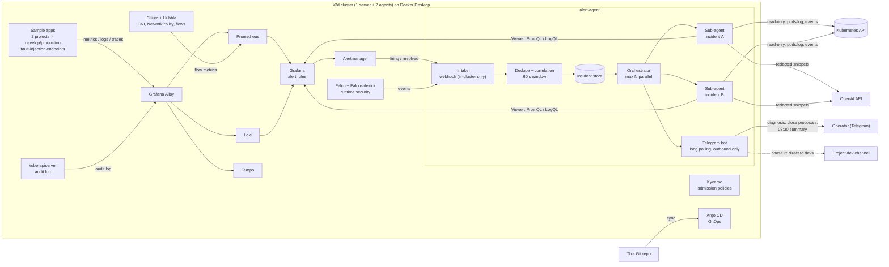

# Harness-K8s-Homelab

**[English](#english) · [Tiếng Việt](#tiếng-việt)**

A production-like Kubernetes homelab running entirely in Docker on one workstation, plus an AI agent harness
that triages alerts in real time.
Homelab Kubernetes mô phỏng production, chạy hoàn toàn trong Docker trên một máy, kèm một AI agent harness phân
loại cảnh báo theo thời gian thực.



---

## English

> **A scaled-down homelab of a real production setup.** Every flow here (GitOps delivery, CI security gates,
> ingress, admission and network policy, observability, alert routing and chat-ops triage) mirrors the platform
> I designed and operated in production at **DFM** across two Kubernetes clusters. The homelab runs the same
> flows on one machine, with open-source substitutes where the production tool is too heavy for a laptop.
> No company data, hostnames or credentials are included. The AI triage agent is the new part, built on top of
> the alert pipeline that ran in production.

> **Status:** specification phase (Spec-Driven Development with GitHub Spec Kit). Implementation follows
> `/speckit-plan` → `/speckit-tasks` → `/speckit-implement`.

### Why

On-call ends at 17:30. Alerts that fire overnight pile up until the next morning: out of 100 alerts, ~80 are the
same 5xx error from one app. The goal is to arrive in the morning to a handful of incidents that are already
diagnosed, with evidence, and with the message to developers ready to send.

### Production at DFM → this homelab

| Flow | Production (DFM) | Homelab |
|---|---|---|
| Clusters | 2 clusters (France, Vietnam), multi-node, kubeadm / RKE2 | 1 k3d cluster, 1 server + 2 agents |
| Delivery | Tag-driven CI → image tag written to GitOps repo → Argo CD sync, shared Helm chart for every app | Same model: GitHub Actions → GitOps → Argo CD, shared chart |
| CI security gates | SonarQube, Trivy (fail on HIGH/CRITICAL), DAST, SBOM to Dependency-Track, auto-rollback | Equivalent open-source gates in GitHub Actions |
| Ingress | Edge reverse proxy (TLS) → Traefik + Gateway API (shared Gateway, per-app HTTPRoute) | Traefik + Gateway API on localhost |
| Admission | Pod Security + "internal registry only" image policy | Kyverno + Pod Security `restricted`, local registry allow-list |
| Network | CNI with NetworkPolicy, default-deny, quarantine label | Cilium + Hubble, default-deny |
| Runtime / SIEM | Falco, Wazuh SIEM | Falco (Wazuh too heavy for one host) |
| Secrets | Vault + External Secrets, Sealed Secrets per cluster | Sealed Secrets |
| Observability | Grafana, Prometheus, Loki, Tempo, Alloy, OpenTelemetry at 100 % sampling | Same stack, in-cluster |
| Alerting | Webhook receiver → fingerprint dedupe → chat room with commands (`#id safe/done/real`), monthly incident table | Same flow on Telegram, **plus the AI agent** that diagnoses each incident |

### What the agent does

| Situation | Behaviour |
|---|---|
| One alert fires | Opens an incident, one sub-agent reads logs + metrics for that window, posts a diagnosis (label: infra / app / unknown, confidence, evidence links) |
| 10 alerts in 2 minutes | Groups by fingerprint and by project/time correlation, runs one sub-agent per incident in parallel, sends one message per incident |
| Same alert keeps firing | Increments the counter silently; messages again only on severity change, recovery or re-open |
| Looks like noise | Proposes closing with a reason; operator approves with one command. Patterns the operator marks *trusted* close automatically |
| Security / audit / node / storage / certificate | Never auto-closed |
| App (business) error | Drafts a message for the project's developers. Phase 1: operator forwards it. Phase 2: sent directly, per-project switch |
| 08:30 on workdays | Summary of everything since 17:30 the previous workday |

Guard rails ([constitution](.specify/memory/constitution.md)): read-only credentials only, secrets redacted before
anything reaches the model or Telegram, every conclusion cites evidence, daily cost cap, no inbound ports from the
Internet.

### Repository layout

```
.specify/              Spec Kit config, templates and the project constitution
.claude/skills/        Spec Kit commands for the coding agent
specs/
  001-realtime-alert-triage/   what the alert agent must do
  002-homelab-platform/        what the homelab cluster must provide
docs/
  architecture.md      homelab and alert flow, component by component
  decisions.md         why k3d, Cilium, Falco, OpenAI, Telegram polling, ...
.env.example           every setting the stack reads; copy to .env (never committed)
```

Created by the implementation phase: `platform/` (k3d config, Argo CD apps, Helm values), `apps/` (sample apps),
`agent/` (alert-agent source), `.github/workflows/` (CI).

### Requirements

- Windows 11 with Docker Desktop (WSL2), ~10 GB RAM free for the homelab
- A Telegram bot (create it with @BotFather) and an OpenAI API key; without them the agent runs in demo mode

### Spec-Driven workflow

```powershell
uv tool install specify-cli --from "git+https://github.com/github/spec-kit.git@v1.3.1"
# inside the coding agent:
/speckit-plan      # technical plan per spec
/speckit-tasks     # ordered, testable tasks
/speckit-implement # build
```

---

## Tiếng Việt

> **Bản homelab thu nhỏ của một hệ thống production thật.** Mọi luồng ở đây (triển khai GitOps, các cổng bảo mật
> trong CI, cửa vào, admission và network policy, giám sát, định tuyến cảnh báo và xử lý cảnh báo qua chat) giống
> nền tảng tôi đã thiết kế và vận hành production tại **DFM** trên hai cụm Kubernetes. Homelab chạy cùng các luồng
> đó trên một máy, dùng công cụ mã nguồn mở thay thế ở chỗ công cụ production quá nặng cho laptop. Repo không chứa
> dữ liệu, tên máy chủ hay thông tin đăng nhập của công ty. Agent AI phân loại cảnh báo là phần mới, xây trên luồng
> cảnh báo đã chạy production.

> **Trạng thái:** giai đoạn đặc tả (Spec-Driven Development với GitHub Spec Kit). Triển khai đi theo
> `/speckit-plan` → `/speckit-tasks` → `/speckit-implement`.

### Vì sao

Ca trực kết thúc lúc 17:30. Cảnh báo bắn ban đêm dồn tới sáng hôm sau: 100 cảnh báo thì khoảng 80 cái là cùng một
lỗi 5xx của một app. Mục tiêu: sáng đến chỉ còn vài sự cố, đã được chẩn đoán, có bằng chứng, và tin nhắn cho dev đã
soạn sẵn.

### Production tại DFM → homelab này

| Luồng | Production (DFM) | Homelab |
|---|---|---|
| Cụm | 2 cụm (Pháp, Việt Nam), nhiều node, kubeadm / RKE2 | 1 cụm k3d, 1 server + 2 agent |
| Triển khai | CI theo tag → ghi image tag vào repo GitOps → Argo CD đồng bộ, một Helm chart dùng chung cho mọi app | Cùng mô hình: GitHub Actions → GitOps → Argo CD, chart dùng chung |
| Cổng bảo mật CI | SonarQube, Trivy (chặn HIGH/CRITICAL), DAST, SBOM gửi Dependency-Track, tự rollback | Các cổng mã nguồn mở tương đương trong GitHub Actions |
| Cửa vào | Reverse proxy biên (TLS) → Traefik + Gateway API (Gateway dùng chung, HTTPRoute theo app) | Traefik + Gateway API trên localhost |
| Admission | Pod Security + chính sách "chỉ image từ registry nội bộ" | Kyverno + Pod Security `restricted`, danh sách registry cục bộ |
| Mạng | CNI có NetworkPolicy, mặc định chặn, nhãn cách ly | Cilium + Hubble, mặc định chặn |
| Runtime / SIEM | Falco, Wazuh SIEM | Falco (Wazuh quá nặng cho một máy) |
| Bí mật | Vault + External Secrets, Sealed Secrets theo từng cụm | Sealed Secrets |
| Giám sát | Grafana, Prometheus, Loki, Tempo, Alloy, OpenTelemetry lấy mẫu 100 % | Cùng bộ, chạy trong cụm |
| Cảnh báo | Bộ nhận webhook → gộp theo dấu vân tay → phòng chat có lệnh (`#id safe/done/real`), bảng sự cố theo tháng | Cùng luồng trên Telegram, **thêm agent AI** chẩn đoán từng sự cố |

### Agent làm gì

| Tình huống | Hành vi |
|---|---|
| Một cảnh báo bắn | Mở sự cố, một sub-agent đọc log + số liệu trong khoảng thời gian đó, đăng chẩn đoán (nhãn: hạ tầng / nghiệp vụ / chưa rõ, mức tin cậy, link bằng chứng) |
| 10 cảnh báo trong 2 phút | Gộp theo dấu vân tay và theo dự án/thời gian, mỗi sự cố một sub-agent chạy song song, mỗi sự cố một tin |
| Một cảnh báo bắn mãi | Chỉ tăng bộ đếm, chỉ nhắn lại khi đổi mức nghiêm trọng, hồi phục hoặc mở lại |
| Trông như nhiễu | Đề xuất đóng kèm lý do; người vận hành duyệt bằng một lệnh. Mẫu đã đánh dấu *tin cậy* thì tự đóng |
| Bảo mật / audit / node / lưu trữ / chứng chỉ | Không bao giờ tự đóng |
| Lỗi nghiệp vụ của app | Soạn tin cho dev dự án. Giai đoạn 1: người vận hành tự chuyển. Giai đoạn 2: gửi thẳng, bật theo từng dự án |
| 08:30 ngày làm việc | Tóm tắt mọi thứ từ 17:30 ngày làm việc trước |

Hàng rào an toàn ([constitution](.specify/memory/constitution.md)): chỉ dùng thông tin xác thực chỉ đọc, che bí mật
trước khi gửi cho mô hình hay Telegram, mọi kết luận kèm bằng chứng, có trần chi phí theo ngày, không mở cổng nào
nhận kết nối từ Internet.

### Cấu trúc repo

```
.specify/              cấu hình Spec Kit, template và constitution của dự án
.claude/skills/        lệnh Spec Kit cho coding agent
specs/
  001-realtime-alert-triage/   agent cảnh báo phải làm gì
  002-homelab-platform/        cụm homelab phải có gì
docs/
  architecture.md      homelab và luồng cảnh báo, từng thành phần
  decisions.md         vì sao chọn k3d, Cilium, Falco, OpenAI, Telegram polling, ...
.env.example           mọi biến cấu hình; chép sang .env (không bao giờ commit)
```

Giai đoạn triển khai sẽ tạo thêm: `platform/` (cấu hình k3d, app Argo CD, Helm values), `apps/` (app mẫu),
`agent/` (mã nguồn alert-agent), `.github/workflows/` (CI).

### Yêu cầu

- Windows 11 có Docker Desktop (WSL2), còn trống khoảng 10 GB RAM cho homelab
- Một Telegram bot (tạo bằng @BotFather) và OpenAI API key; thiếu thì agent chạy chế độ demo

### Quy trình Spec-Driven

```powershell
uv tool install specify-cli --from "git+https://github.com/github/spec-kit.git@v1.3.1"
# trong coding agent:
/speckit-plan      # kế hoạch kỹ thuật cho từng spec
/speckit-tasks     # danh sách việc có thứ tự, kiểm thử được
/speckit-implement # xây dựng
```

---

## Author · Tác giả

**Hoang Van Dung** — DevOps engineer · [github.com/dunghv107](https://github.com/dunghv107)
